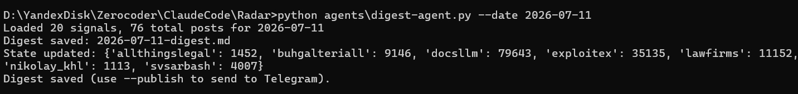
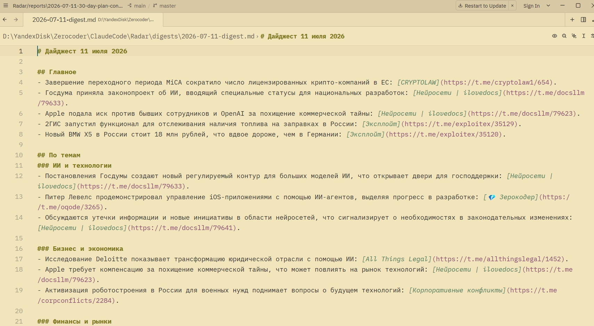
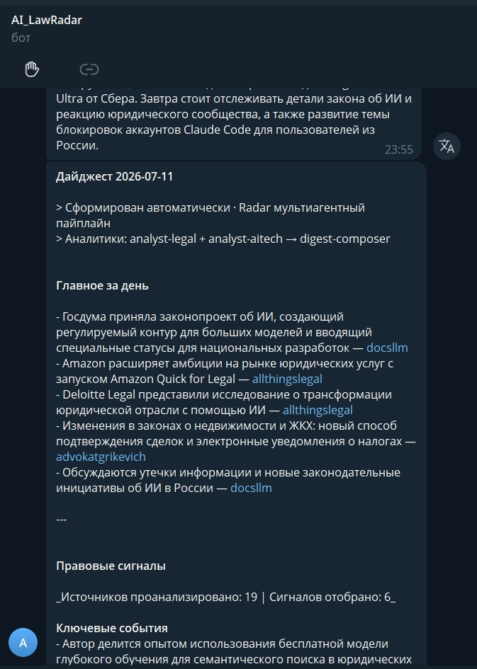

# TG Radar

**Мультиагентный мониторинг Telegram-каналов про ИИ в праве с автопубликацией дайджеста.**

Radar собирает сообщения из ~85 Telegram-каналов по теме ИИ и legal-tech, отсеивает шум через OpenAI, готовит аналитический дайджест силами нескольких агентов и публикует его в Telegram-канал. Ручной час чтения ленты превращается в готовую выжимку за день.

У проекта нет HTML-страниц, форм и UI – это конвейер данных: источники → агенты → публикация. Полное описание проекта по структуре выпускного задания – в [PROJECT.md](PROJECT.md).

## Скриншоты

> Скриншоты работающего проекта. Замените плейсхолдеры на свои файлы в папке `images/`.

**Запуск пайплайна в терминале**



**Готовый дайджест (Markdown)**



**Опубликованный пост в Telegram-канале**



## Что делает Radar

1. **Сбор** – забирает новые сообщения из ~85 Telegram-каналов по протоколу MTProto.
2. **Фильтрация** – отсеивает шум через OpenAI, оставляет сигналы по ИИ и legal-tech.
3. **Анализ** – специализированные агенты (`analyst-legal`, `analyst-aitech`, `analyst-finance-health`) разбирают сигналы по направлениям.
4. **Композиция** – `digest-composer` собирает разборы агентов в единый дайджест.
5. **Публикация** – готовый дайджест публикуется в Telegram-канал через Bot API.

## Запуск локально

```bash
# 1. Клонировать репозиторий
git clone https://github.com/advocatalexy-cell/TG_Radar.git
cd TG_Radar

# 2. Виртуальное окружение и зависимости
python -m venv .venv
source .venv/bin/activate          # Windows: .venv\Scripts\activate
pip install -r requirements.txt

# 3. Секреты (см. раздел «Секреты») – скопировать и заполнить
cp .env.example .env               # затем вписать свои ключи

# 4. Запустить весь пайплайн
python scripts/run-pipeline.py

# Частичный прогон
python scripts/run-pipeline.py --skip-fetch      # без сбора, только фильтр + дайджест
python scripts/filter-signals.py --date 2026-05-20   # backfill конкретной даты
```

Готовый дайджест появится в `digests/YYYY-MM-DD-digest.md`.

## Архитектура

Сбор, анализ и публикация выполняются на VPS отдельными заданиями.
Анализ перенесен с Claude Routine на Codex с авторизацией через подписку ChatGPT.

| Звено | Задача | Почему там |
|---|---|---|
| **VPS** (u1host) | Сбор из Telegram (MTProto/Telethon) и публикация (Bot API) | Оба вида трафика не проходят через egress-прокси облачной песочницы Anthropic: MTProto рвется с ошибкой на уровне TCP, Bot API возвращает 403 Forbidden от прокси |
| **Codex на VPS** (отдельный пользователь) | Параллельный ИИ-анализ и сборка дайджеста | Авторизация через подписку ChatGPT; API-ключи из окружения анализа исключены |

Связующий слой – публичный GitHub-репозиторий [`advocatalexy-cell/TG_Radar`](https://github.com/advocatalexy-cell/TG_Radar):

- VPS пушит туда сырые данные после сбора;
- Codex читает отдельную копию данных, выполняет анализ; служебный процесс коммитит готовый дайджест в `master`;
- VPS публикует дайджест из репозитория в канал.

Три аналитика выполняются одновременно отдельными сессиями Codex.
Композитор запускается после успешного завершения всех аналитиков.

```
Telegram-каналы (~85)
        │  MTProto (Telethon)
        ▼
      VPS: сбор
        │  git push (сырые данные)
        ▼
   GitHub-репозиторий
        │  git pull
        ▼
Codex на VPS: analyst-legal + analyst-aitech + analyst-finance-health → digest-composer
        │  git push (готовый дайджест)
        ▼
   GitHub-репозиторий
        │  git pull
        ▼
      VPS: публикация (Bot API)
        │
        ▼
   Telegram-канал
```

## Структура репозитория

```
Radar/
├── sources/          # конфиги источников (channels.json)
├── scripts/          # сбор, фильтрация, оркестратор, публикация
├── agents/           # digest-agent, промпт post-adapter
├── data/raw/         # сырые данные из источников (только чтение)
├── data/processed/   # отфильтрованные сигналы
├── data/analysis/    # разборы агентов по направлениям
├── digests/          # готовые дайджесты по датам
├── posts/            # адаптированные посты под площадки (JSON)
├── .claude/          # агенты, команды и скиллы Claude Code
├── PROJECT.md        # описание проекта по структуре урока
└── README.md         # этот файл
```

## Скиллы Claude Code

- **`post-adapter`** – превращает новость или фрагмент дайджеста в готовые посты под Telegram-канал Radar и корпоративный портал Bitrix24 (JSON в `posts/`).
- **`radar-dev`** – помогает Claude Code работать с этим репозиторием: понимать структуру, запускать пайплайн, вносить изменения, обновлять README, проверять ошибки и готовить проект к публикации.

Скиллы лежат в `.claude/skills/` и публикуются вместе с репозиторием.

## Стек

- Python 3.12, venv
- Telethon (MTProto-клиент для сбора)
- Telegram Bot API (публикация)
- OpenAI API (фильтрация сигналов)
- Codex CLI через подписку ChatGPT (анализ и композиция)
- cron и systemd timer (расписание на VPS)

Фильтрация использует `gpt-6-luna`, получает полный текст каждого поста без
обрезки на 2000 символах и возвращает JSON с категорией, кратким описанием и тегами.
Модель задается отдельной переменной `OPENAI_FILTER_MODEL` в `.env` на VPS;
она имеет приоритет над общей `OPENAI_MODEL`. Для GPT-6 отключено рассуждение
(`reasoning_effort=none`), лимит ответа – 512 токенов. Основной анализ через
Codex по подписке настроен отдельно.

## Расписание (VPS, время МСК)

| Время | Задача |
|---|---|
| 17:00 | Сбор сообщений из Telegram-каналов |
| 18:00 | Codex: параллельный анализ, композиция, сохранение в `master` (systemd timer) |
| 18:30 | Публикация дайджеста в Telegram-канал |

## Анализ через подписку ChatGPT на VPS

Codex установлен для пользователя `radar-analysis`, домашняя папка –
`/var/lib/radar-codex`, модель – `gpt-6.1-sol`. Вход выполнен через
`codex login --device-auth`. Установлено `forced_login_method = "chatgpt"`;
API-ключи не передаются, автоматического перехода на API нет.
Расходуются лимиты Codex в подписке. При исчерпании лимитов или потере
авторизации задание завершается ошибкой, а готовый дайджест не подменяется заглушкой.

Файлы `scripts/run-subscription-analysis.py`, `scripts/run-cloud-analysis.py`
(парсер плана) и `scripts/run-subscription-daily.sh` устанавливаются на VPS
в `/usr/local/lib/radar` с владельцем root. Файлы `scripts/radar-subscription-*.service`
и `scripts/radar-subscription-daily.timer` – в `/etc/systemd/system`.
Серверные файлы должны обновляться отдельно после изменения в репозитории.

Сбор и фильтрация используют `/opt/radar`. Анализ получает только копию
processed за нужную дату, конфигурацию источников и инструкции агентов.
Команды shell и сеть инструментов в Codex отключены; исходные данные
передаются агентам в запросе. Systemd закрывает пользователю анализа доступ
к `/opt/radar` и `/root`. Авторизация ChatGPT хранится только в приватной папке
служебного пользователя. Строки сессии и токены не входят в репозиторий.

Список аналитиков и их задания берутся из актуальной
`.claude/commands/run-analysis.md`, инструкции – из `.claude/agents/`.
Состав папок и отсутствие фильтрации по signal/score соответствуют инструкциям
ролей. Проверяется полное совпадение URL секции с постами активных каналов
ее папки; композитор обязан сохранить все тематические секции без изменений.
Отчеты считают включенные посты, не объявляют весь поток важными сигналами.

Отдельный привилегированный этап сохраняет только разрешенные секции и
дайджест текущей даты из `/opt/radar-codex-delivery` в `master`, затем проверяет
коммит в `origin/master`. При конфликте пытается сохранить резервную ветку
`codex/radar-ДАТА-ВРЕМЯ` и завершает запуск с ошибкой. Уже существующий
дайджест пропускается. Ожидание свежих данных – до 100 минут.
Исторические и тестовые результаты не отправляются.

Управление на VPS:

```bash
systemctl status radar-subscription-daily.timer
systemctl list-timers radar-subscription-daily.timer
journalctl -u radar-subscription-analysis.service -u radar-subscription-daily.service
systemctl start radar-subscription-daily.service  # ручной рабочий запуск за сегодня
```

Результаты и отчеты сохраняются в `/var/lib/radar-codex/runs/`.
Ротация с удалением не настроена; место нужно контролировать.
Проверки без модели и внешней сети: `python scripts/test-subscription-analysis.py`.
После тестирования новой схемы старую Routine Radar в Claude нужно отключить.

## Альтернативный анализ через GitHub Actions (отключен)

Резервный вариант: `.github/workflows/radar-daily-analysis.yml`.
Workflow отключен по решению пользователя; ключи в GitHub не добавлялись.
Этот вариант использует платный API и не нужен для анализа через подписку.
После включения workflow запускается ежедневно в 18:00 МСК (15:00 UTC) и вручную
через Actions → Radar daily analysis → Run workflow. GitHub может задерживать запуск.
Компьютер пользователя для выполнения не нужен.

Настройка в репозитории GitHub:

1. Settings → Secrets and variables → Actions → New repository secret:
   имя `OPENAI_API_KEY`, значение – ключ OpenAI API. Не вставлять ключ в инструкции.
2. При необходимости задать переменную `RADAR_CODEX_MODEL` с идентификатором
   доступной API-модели Codex. Без нее используется выбор Codex по умолчанию.
3. Разрешить GitHub Actions и убедиться, что правила ветки `master` допускают
   коммиты `github-actions[bot]`. Workflow запрашивает `contents: write`
   только в отдельном задании сохранения; персональный GitHub-токен не требуется.
4. Загрузить изменения в основную ветку репозитория и выполнить Run workflow.
   Расписание GitHub работает только для workflow в ветке по умолчанию.
5. После успешной проверки коммита в `master` отключить старый Routine Radar
   в Claude. До этого не запускать оба анализатора одного дня одновременно.

Задание ждет сегодняшние processed-файлы до 100 минут. Дата фиксируется по
Europe/Moscow. Уже существующий дайджест пропускается. Список аналитиков и
их задания читаются из актуального `.claude/commands/run-analysis.md`, инструкции –
из `.claude/agents/`. Все аналитики работают параллельно, затем запускается
композитор. Число включенных постов по каждому аналитику выводится отдельно.
Зависимости – только `openai` и `python-dotenv`; Telethon не устанавливается.

Отдельное задание проверяет результаты и отправляет только файлы анализа и
дайджест за выбранную дату в `master`. При отказе делает попытку сохранения
в `codex/radar-ДАТА-ID`, завершает запуск с ошибкой и сообщает о проблеме.
Успех проверяется в `origin/master`. Отчеты и резервные результаты доступны
в Summary и артефакте `radar-daily-result` в течение 14 дней.
В облачное задание не передаются ключи Telegram, сбор и публикация остаются на VPS.
OpenAI API и ресурсы GitHub Actions оплачиваются по условиям соответствующих аккаунтов.

Локальная проверка без обращений к API: `python scripts/test-cloud-analysis.py`.
Файл `scripts/daily-analysis-task.md` относится к прежнему локальному варианту;
облачный workflow его не использует.

## Секреты

Сбор и публикация получают секреты через `.env` на VPS – никогда не через код и не в git:

- `TELEGRAM_API_ID`
- `TELEGRAM_API_HASH`
- `TELEGRAM_PHONE`
- `TELEGRAM_SESSION_STRING`
- `TELEGRAM_BOT_TOKEN`
- `TELEGRAM_CHAT_ID`
- `OPENAI_API_KEY`

Доступ к VPS – по SSH-ключу. Для GitHub на сервере сгенерирован отдельный deploy-key; приватная часть ключа никогда не покидала VPS.
Codex использует отдельный приватный кеш авторизации ChatGPT служебного пользователя;
для анализа перечисленные API-ключи и ключи Telegram не требуются.

## Статус

Проведен полный end-to-end прогон в реальном времени – дайджест успешно дошел до Telegram-канала. Пайплайн работает по расписанию.

## Лицензия

–
